# Joinville · Omarchy 4

Tema escuro para o Omarchy inspirado em **Joinville (SC)**: o azul da bandeira municipal
sobre a Baía da Babitonga, o ouro do brasão, a madeira e a telha das casas enxaimel,
as palmeiras imperiais, as orquídeas da Festa das Flores e o ferro em fusão da
"Manchester Catarinense". Dez wallpapers em pixel art contam a cidade, de 1851 até hoje.

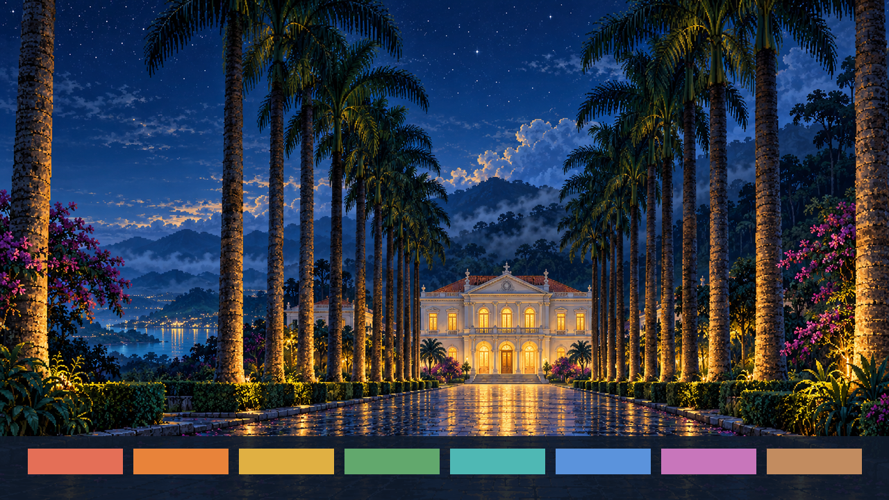

## Instalar

```sh
omarchy theme install https://github.com/cesarfilho/omarchy-joinville-theme
```

Ou, a partir de um clone local:

```sh
ln -s "$PWD" ~/.config/omarchy/themes/joinville
omarchy theme set joinville
omarchy theme bg next   # alterna entre os wallpapers
```

## Wallpapers

Dez wallpapers em pixel art, 1672 × 941 (16:9). Clique para abrir o PNG.

| | |
| --- | --- |
| [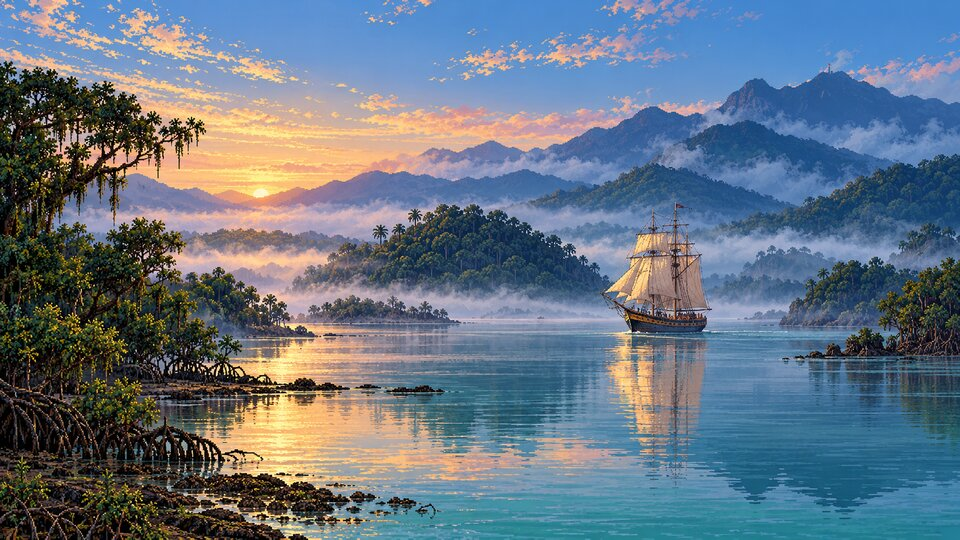](backgrounds/01-colon-1851.png)<br>Colon, 1851 | [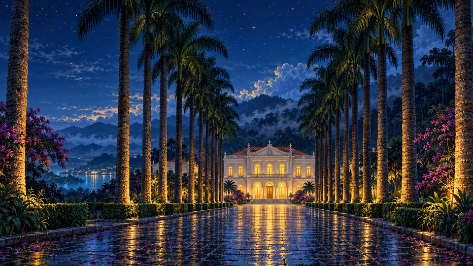](backgrounds/02-rua-das-palmeiras.png)<br>Rua das Palmeiras |
| [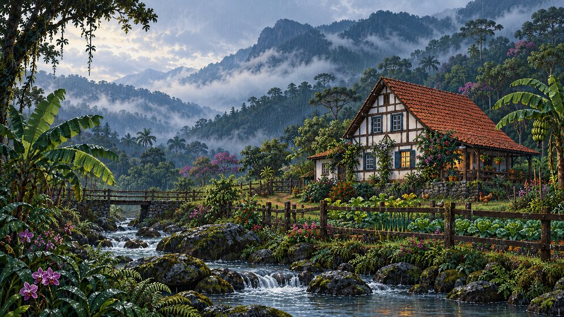](backgrounds/03-enxaimel-estrada-bonita.png)<br>Enxaimel — Estrada Bonita | [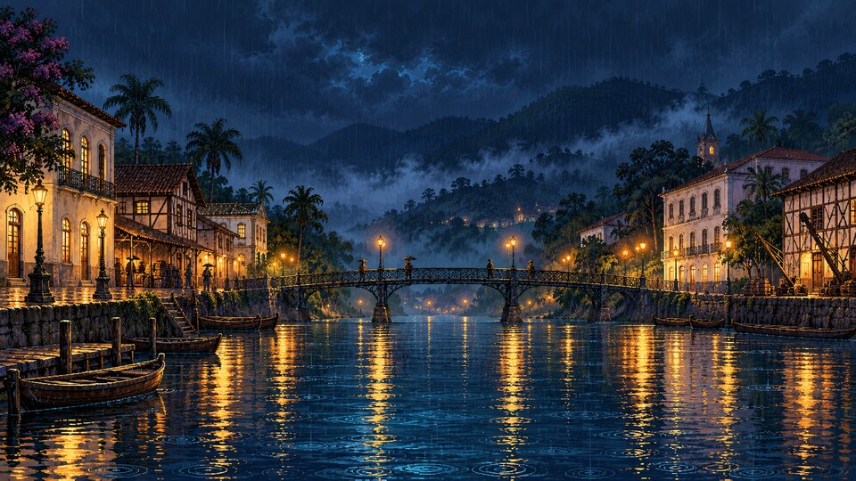](backgrounds/04-rio-cachoeira.png)<br>Rio Cachoeira |
| [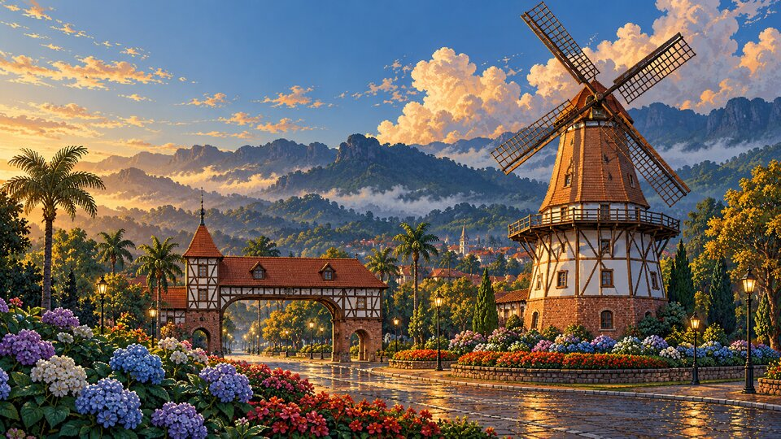](backgrounds/05-moinho.png)<br>O Moinho | [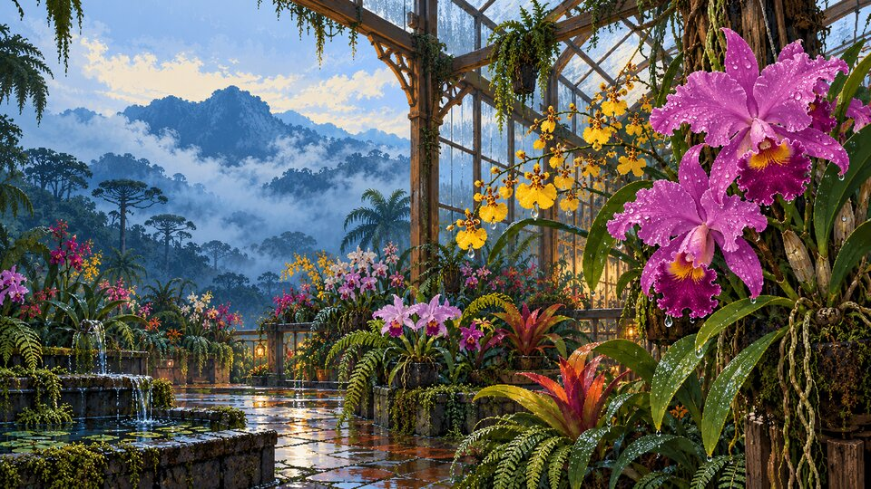](backgrounds/06-festa-das-flores.png)<br>Festa das Flores |
| [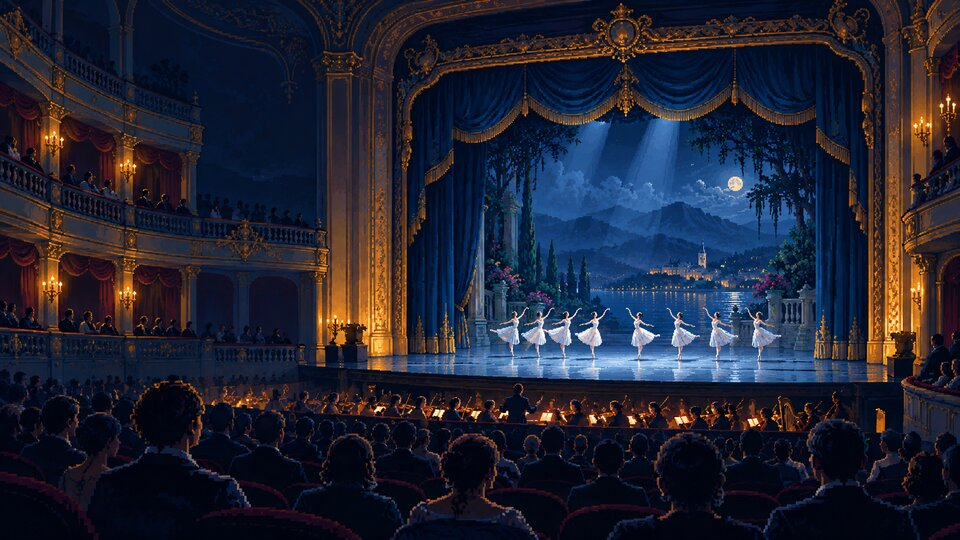](backgrounds/07-noite-de-danca.png)<br>Noite de Dança | [](backgrounds/08-fundicao.png)<br>Fundição |
| [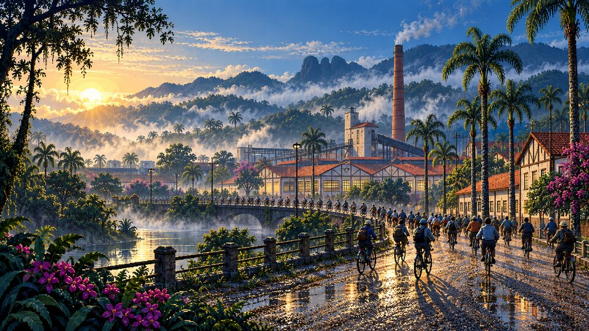](backgrounds/09-turno-de-bicicleta.png)<br>Turno de Bicicleta | [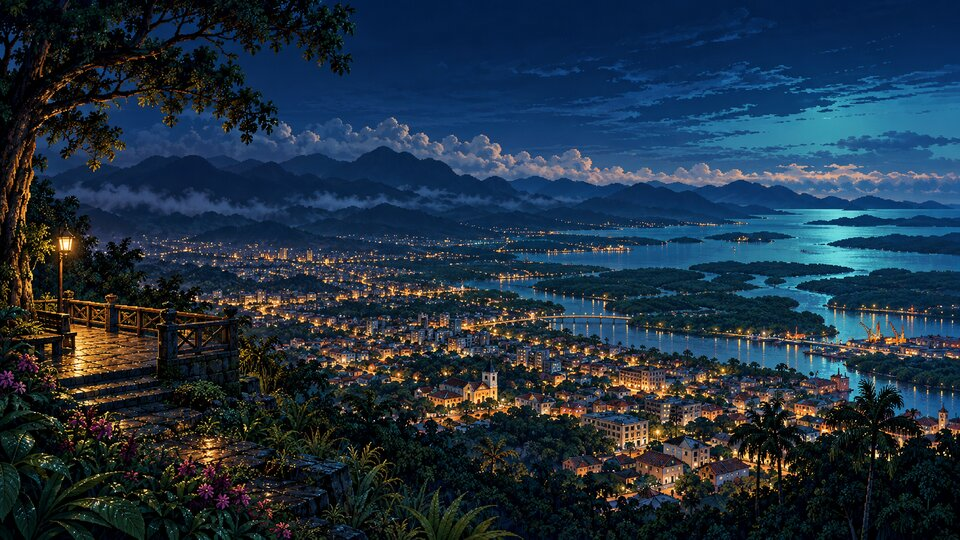](backgrounds/10-mirante-babitonga.png)<br>Mirante — Babitonga |

### O que cada um representa

| # | Cena | O que representa |
|---|---|---|
| 01 | Colon, 1851 | Chegada da barca *Colon* com imigrantes suíços, alemães e noruegueses — fundação da Colônia Dona Francisca |
| 02 | Rua das Palmeiras | Alameda de palmeiras imperiais até o Palácio dos Príncipes (Museu Nacional de Imigração) |
| 03 | Enxaimel — Estrada Bonita | Arquitetura enxaimel rural, garoa e Mata Atlântica |
| 04 | Rio Cachoeira | O centro histórico à beira do rio numa noite de chuva |
| 05 | O Moinho | O moinho na entrada da cidade |
| 06 | Festa das Flores | Orquídeas — a "Cidade das Flores" |
| 07 | Noite de Dança | Festival de Dança e Escola Bolshoi — a "Cidade da Dança" |
| 08 | Fundição | Indústria metal-mecânica — a "Manchester Catarinense" |
| 09 | Turno de Bicicleta | Operários a caminho da fábrica — a "Cidade das Bicicletas" |
| 10 | Mirante — Babitonga | A cidade e a baía vistas do Morro da Boa Vista |

Os prompts de cada imagem estão em [`docs/prompts/`](docs/prompts/) e o manifesto
(arquivo, resolução, sha256) em [`docs/backgrounds.json`](docs/backgrounds.json).

## Unlock

Monograma em pixel art com o losango branco da bandeira de Joinville, para a tela de
boot / desbloqueio de disco. Depois de instalar o tema, selecione **Joinville** em
**Style > Unlock** (ou `omarchy plymouth set by theme joinville`).

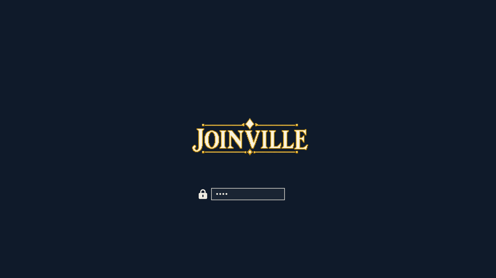

Para regenerar o preview:

```sh
omarchy plymouth preview '#0F1A2A' '#EEEAE0' unlock.png preview-unlock.png
```

## Paleta

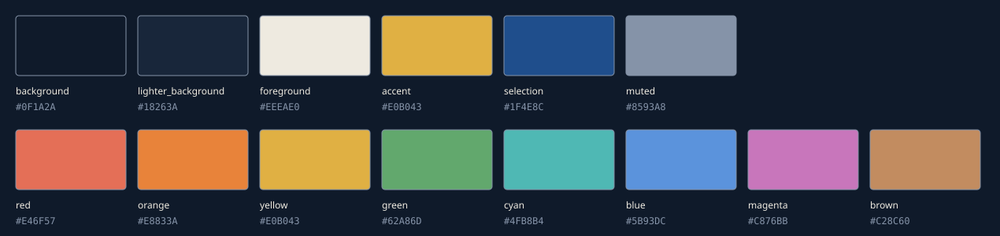

| Papel | Cor | Origem |
|---|---|---|
| Fundo | `#0F1A2A` | Azul da bandeira, noite na Babitonga |
| Superfícies | `#18263A` | Barra, menus, launcher |
| Texto | `#EEEAE0` | Losango branco da bandeira / reboco do enxaimel |
| Destaque | `#E0B043` | Ouro do brasão (flor-de-lis, coroa, roda dentada) |
| Seleção | `#1F4E8C` | Azul heráldico |
| Texto secundário | `#8593A8` | Névoa da Serra do Mar |
| red / brown | `#E46F57` / `#C28C60` | Telha e madeira do enxaimel |
| orange | `#E8833A` | Ferro em fusão |
| green | `#62A86D` | Palmeiras imperiais, Mata Atlântica |
| cyan | `#4FB8B4` | Águas da Babitonga |
| magenta | `#C876BB` | Orquídeas da Festa das Flores |

`icons.theme` usa `Yaru-blue-dark`. A casca (`shell.toml`) usa superfícies opacas com
bordas douradas.

Contraste (cores opacas): texto **14.55:1** no fundo, **6.92:1** na seleção; todas as
cores do terminal ≥ **4.5:1** no fundo e nas superfícies. Detalhes em
[`docs/contrast.json`](docs/contrast.json).

## Desenvolvimento

```sh
python3 scripts/check-theme.py        # contraste WCAG → docs/contrast.json
python3 scripts/make-palette-svg.py   # docs/palette.svg a partir de colors.toml
scripts/generate-wallpapers.sh [NN-nome]  # gera wallpapers faltantes via Codex image_gen
python3 scripts/check-wallpapers.py   # valida 16:9 + prompts → docs/backgrounds.json
```

## Créditos

Wallpapers e monograma gerados por IA (Codex `image_gen` embutido, GPT Image) a partir dos
prompts em `docs/prompts/`, revisados visualmente um a um. Resolução nativa do gerador, sem
upscaling.

Estrutura de casca e verificação de contraste adaptadas do tema
[1800](https://github.com/simoz/omarchy-1800-theme).
